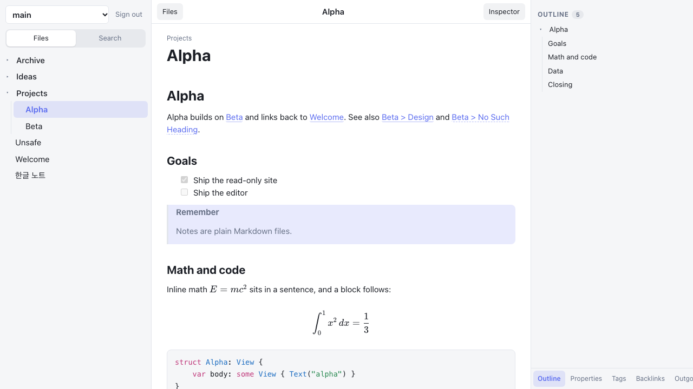
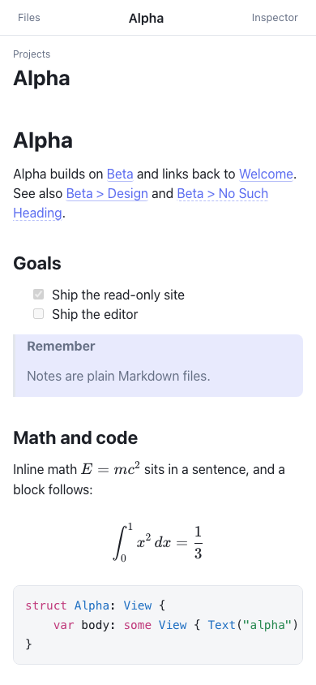

# Andesite-Mun

The second Andesite UI, written in [Mün](https://github.com/kyooni18/Mun): one codebase for the
**web app** (served at `/` by the Andesite Docker deployment) and the **desktop app** (Mün's Tauri 2
`desktop` target). The iOS and macOS apps stay native SwiftUI in `Andesite-iOS-macOS`.

- Plan: [PLAN.md](PLAN.md). Deviations and Mün findings: [docs/decisions.md](docs/decisions.md).
  What works: [docs/parity.md](docs/parity.md).
- Status: Phase 0 (foundations) and Phase 1 (read-only site) are done. Editing is Phase 2.




## Layout

```
src/api/        TypeScript: typed client for /v1, typed errors, service functions
src/api/schemas generated from Andesite/docs/schemas (types.ts + the schema copies the tests use)
src/model/      .mun @Observable models: VaultStore, SearchModel, InspectorModel
src/views/      .mun, one file per SwiftUI counterpart (Sidebar/ Search/ Inspector/ Editor/ ...)
src/ui/         SwiftUI APIs Mün lacks, with SwiftUI's names: NavigationSplitView, DisclosureGroup,
                OutlineGroup (+ URL routing and size class in TS)
src/render/     Markdown -> sanitized HTML (marked, DOMPurify, KaTeX, highlight.js)
src/platform/   web.ts (cookie session) | desktop.ts (Tauri, stub) behind one interface
src/editor/     (Phase 3)
src-tauri/      the desktop shell
tests/unit      vitest        tests/e2e   Playwright against a real server
```

`.mun` is for views and view models; all network and I/O code is typed TypeScript.

## Mün: linked checkout, exact pins

`package.json` pins `@mun-ui/ui`, `core`, `web` and `vite` to exactly `0.2.0`. That release on npm
has no desktop target, so the app **links a local Mün checkout** with `mun link` (details in
[decisions.md](docs/decisions.md)):

```sh
git clone https://github.com/kyooni18/mun ../mun
git -C ../mun checkout "$(cat MUN_REF)"
(cd ../mun && pnpm install && pnpm add -Dw @types/node@22 && pnpm build)
pnpm install
pnpm run link:mun ../mun        # mun link + the desktop host crate
```

## Develop

```sh
pnpm run dev          # http://127.0.0.1:1420, proxies /v1 /auth /sync to $ANDESITE_SERVER (default :8788)
pnpm run typecheck
pnpm test             # vitest
pnpm run build
```

Run a server for it: `ANDESITE_API_TOKEN=$(openssl rand -hex 32) andesite-server serve-all <folder of vaults> --state <dir>`.
The browser needs the cookie to be sent: `localhost` counts as secure for the `Secure` cookie; any
other host needs HTTPS.

## Test

```sh
pnpm run build && pnpm run e2e     # Playwright, trace off
```

`playwright.config.ts` starts `scripts/e2e-stack.mjs`: a real `andesite-server serve-all` on a copy of
[tests/e2e/seed](tests/e2e/seed), behind nginx running the deployment's own `deploy/nginx.conf`,
serving `dist/`. It needs a built `andesite-server` (`ANDESITE_REPO`, default `../Andesite`, or
`ANDESITE_SERVER_BIN`) and nginx (`NGINX_BIN`). To test a real `docker compose` stack instead, copy
`tests/e2e/seed/*` into its vaults folder, deploy the build, and set `E2E_BASE_URL` and `E2E_TOKEN`.

The suites: `phase0` (login, token handling, CSP and cache headers), `browse`, `search`, `links`
(wiki links, backlinks, outline, deep links, Back/Forward), `narrow` (390 px), `contract` (typed client
against every route, validated with the schemas).

## Types from the server's schemas

`src/api/schemas/types.ts` is generated, not written: `pnpm run gen:types [path to Andesite/docs/schemas]`.
CI regenerates it and fails on a difference.

## Deploy the site

```sh
pnpm run deploy [path]     # builds, then replaces the contents of path with dist/
```

`path` defaults to `../Andesite/deploy/www` (or `$ANDESITE_WWW`). The Andesite Dockerfile copies that
folder into the image and nginx serves it at `/`, with `/v1/`, `/auth/` and `/sync/` proxied to the
server. Then `docker compose up --build` in the Andesite repo and open <http://localhost:8790/>.

## Desktop

```sh
pnpm run desktop:check            # validates src-tauri's configuration (no build)
pnpm run desktop:check -- --cargo # + cargo check of the shell (needs the WebView libraries)
pnpm run desktop:dev | desktop:build
```

Phase 0/1 ship the shell and a stub platform adapter; signing in from the desktop app arrives in
Phase 4 (keychain, requests from Rust). See [decisions.md](docs/decisions.md).

## Security notes

- The API token is only typed into the login form and sent once. The server answers with an
  `HttpOnly; Secure; SameSite=Strict; Path=/v1` cookie; the token is never put in storage, URLs or logs.
- Notes are untrusted. Markdown is rendered, then sanitized with DOMPurify, then enhanced; the
  deployment's CSP allows scripts from `'self'` only.
- Nothing is cached past a revision: a note is read again whenever it is opened, with its `ETag`.
